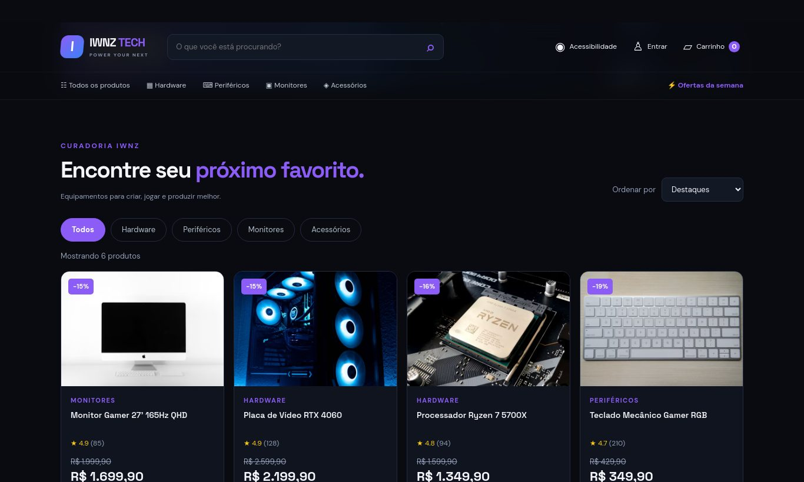
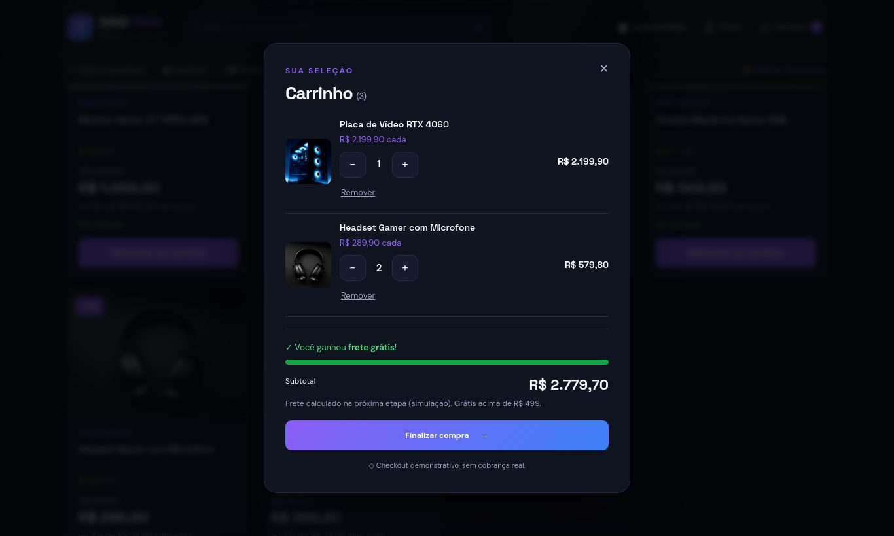
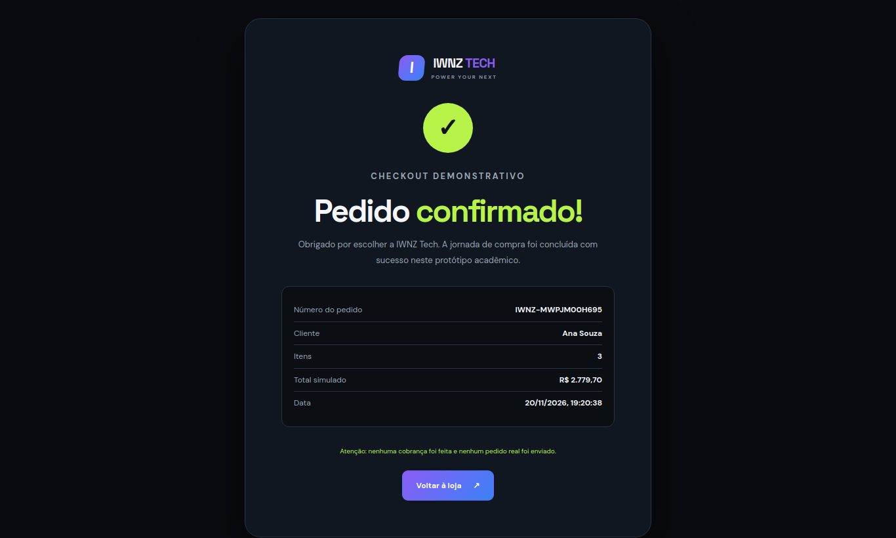
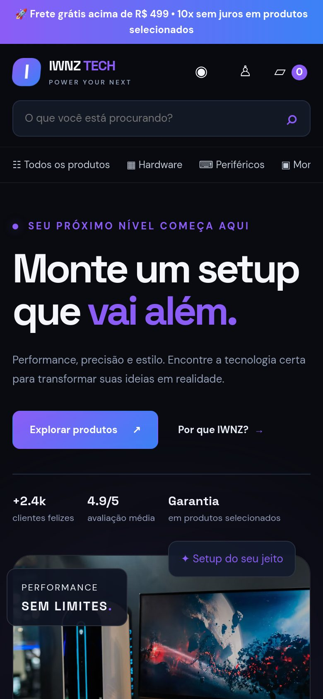
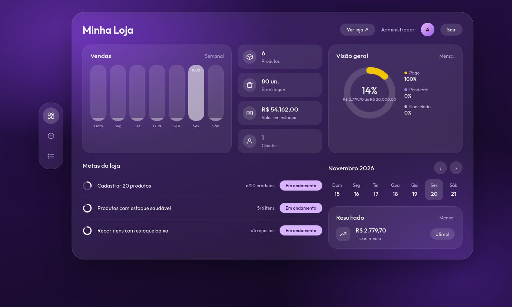
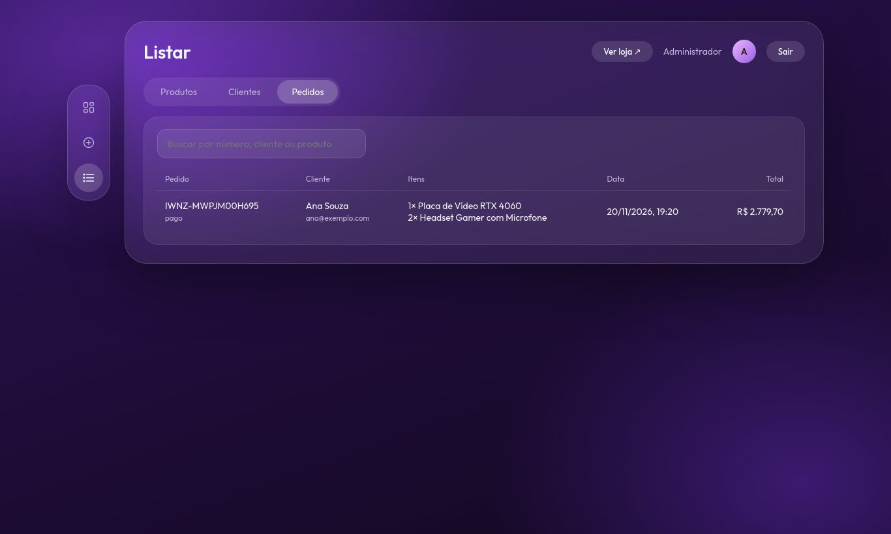
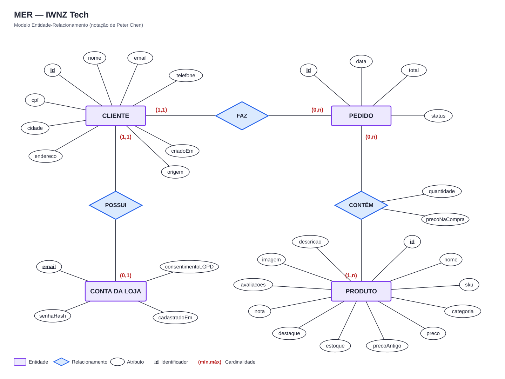
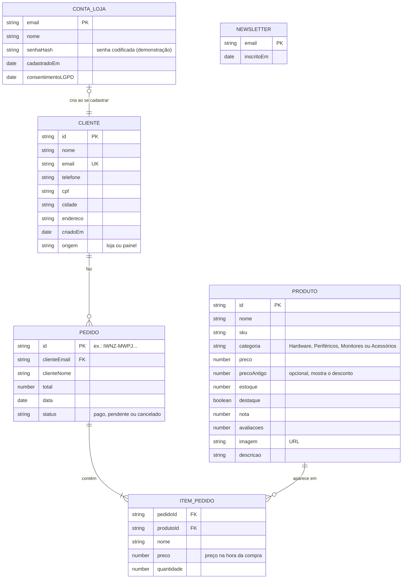

# E-commerce-Loja

Trabalho do Marcelo Boer

**IWNZ Tech** é uma loja virtual de demonstração feita como **trabalho da faculdade**, na disciplina de Design de Interface. É um projeto acadêmico: nenhuma compra, cobrança ou entrega é real, e os produtos, preços e avaliações são ilustrativos.

## O que tem no projeto

- **Loja (`Loja/`)**: vitrine de produtos de tecnologia (hardware, periféricos, monitores e acessórios) com busca, filtros por categoria, ordenação, carrinho, cadastro e login de clientes, checkout simulado e página de pedido confirmado.
- **Painel da loja (`Dashboard/`)**: área do administrador ("Minha Loja") para cadastrar e listar produtos e clientes, ver os pedidos feitos na loja e acompanhar vendas da semana, meta do mês e ticket médio.
- **Dados compartilhados (`Compartilhado/dados.js`)**: catálogo inicial e funções usadas pelas duas partes. O que é cadastrado no painel aparece na loja, e as contas e pedidos feitos na loja aparecem no painel.
- **Ícone do site (`Compartilhado/favicon.svg`)**: o "I" da marca IWNZ Tech, com o mesmo degradê roxo e azul do cabeçalho, usado na aba do navegador da loja, da página de pedido confirmado e do painel.

Também foram trabalhados pontos de experiência e acessibilidade: alto contraste, texto maior, redução de animações, navegação por teclado, e textos de privacidade com as opções de baixar e excluir os próprios dados (LGPD).

## Prints

### Loja

Página inicial:


Catálogo com filtros por categoria e ordenação:



Carrinho, com o aviso de frete grátis:



Pedido confirmado (checkout simulado):



No celular:



### Painel da loja

Visão geral com vendas da semana, meta do mês e ticket médio:



Lista de pedidos feitos na loja:



> Os nomes, e-mails e pedidos que aparecem nos prints são fictícios, criados só para a demonstração.

## Banco de dados

O projeto não tem um servidor de banco de dados: tudo fica no `localStorage` do navegador, em listas no formato JSON. Os diagramas abaixo mostram como esses dados se organizam e se relacionam, como seriam num banco de dados.

### MER (Modelo Entidade-Relacionamento)



Como ler o MER:

- **Cliente FAZ Pedido**: cada cliente faz de 0 a muitos pedidos (0,n), e cada pedido é de exatamente 1 cliente (1,1).
- **Pedido CONTÉM Produto**: cada pedido tem de 1 a muitos produtos (1,n), e cada produto pode estar em 0 ou muitos pedidos (0,n). É um relacionamento muitos-para-muitos, com os atributos `quantidade` e `precoNaCompra`, que guarda o preço do produto no momento da compra.
- **Cliente POSSUI Conta da loja**: o cliente pode ter 0 ou 1 conta (0,1). Quem cria conta na loja vira cliente, mas o administrador também pode cadastrar clientes no painel sem conta. Cada conta pertence a exatamente 1 cliente (1,1).
- A lista de e-mails da newsletter não aparece no MER, porque é um cadastro solto, sem ligação com as outras entidades.

### Modelo lógico

Este diagrama mostra os mesmos dados no formato de tabelas, com chaves primárias (PK) e estrangeiras (FK). O relacionamento muitos-para-muitos CONTÉM vira a tabela `ITEM_PEDIDO`.



Onde cada parte fica guardada:

| Tabela | Chave no `localStorage` | Quem grava |
|---|---|---|
| `PRODUTO` | `loja:v2:produtos` | Painel (cadastro e edição) e Loja (baixa do estoque na compra) |
| `CLIENTE` | `loja:v2:clientes` | Loja (ao criar conta) e Painel (cadastro manual) |
| `PEDIDO` e `ITEM_PEDIDO` | `loja:v2:pedidos` (os itens ficam dentro de cada pedido) | Loja, ao finalizar a compra |
| `CONTA_LOJA` | `iwnz_users` | Loja (cadastro e login) |
| `NEWSLETTER` | `iwnz_newsletter` | Loja (formulário de newsletter) |

Observações:

- O e-mail liga a conta da loja ao cliente e o cliente aos pedidos.
- O pedido guarda o nome e o preço de cada item no momento da compra. Assim, editar ou excluir o produto depois não muda pedidos antigos.
- Quando alguém exclui a própria conta (LGPD), o cliente é removido e os pedidos dele ficam anônimos ("Cliente removido"). Os valores continuam contando nos relatórios do painel.

## Tecnologias

HTML, CSS e JavaScript puros, sem frameworks e sem servidor. Todos os dados ficam guardados no próprio navegador (`localStorage` e `sessionStorage`).

## Como rodar

O site precisa ser aberto por um servidor local (abrir o arquivo direto no navegador não funciona):

```bash
python3 -m http.server 8000
```

Depois acesse:

- Loja: http://localhost:8000/Loja/
- Painel: http://localhost:8000/Dashboard/

O login de demonstração do painel é fictício e está em `Dashboard/script.js` (objeto `Auth.DEMO`). Como a loja e o painel usam o mesmo armazenamento do navegador, os dois precisam ser abertos pelo mesmo endereço.
